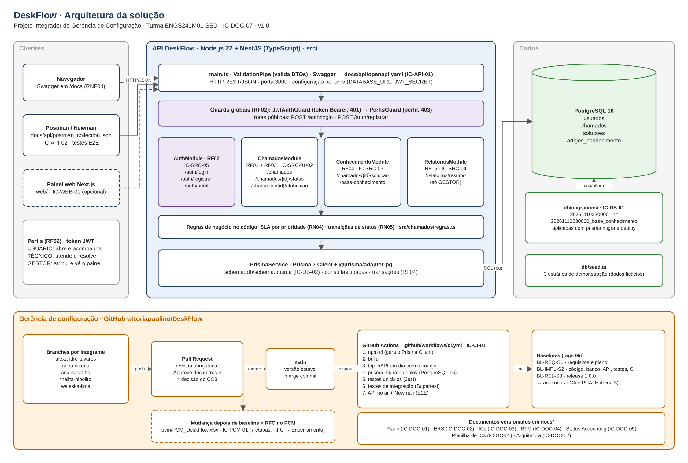

# DeskFlow: Central de Serviços de TI

Projeto Integrador da disciplina **Gerência de Configuração**, curso de Engenharia de Software do Centro Universitário Fametro (Manaus/AM).

O DeskFlow é uma API de central de serviços de TI. Usuários abrem chamados, técnicos atendem dentro do SLA e registram a solução, e gestores acompanham os indicadores. O projeto aplica os quatro pilares da gerência de configuração: **identificação, controle, relato de status e auditoria**.

## Stack

| Camada | Tecnologia |
|---|---|
| API | Node.js 20 + NestJS (TypeScript) |
| Banco de dados | PostgreSQL 16 + Prisma ORM (`db/schema.prisma`, `db/migrations/`) |
| Segurança (RF02) | JWT + guards de perfil (usuário, técnico, gestor) |
| Contrato da API | OpenAPI gerado pelo `@nestjs/swagger` → `docs/api/openapi.yaml` |
| Testes | Jest (unitários), Jest + Supertest (integração), Newman/Postman (E2E) |
| CI | GitHub Actions (`.github/workflows/ci.yml`) |
| Painel web (opcional) | Next.js em `web/` |

## Equipe

| Integrante | Branch | Papel |
|---|---|---|
| Alexandre Tavares | `alexandre-tavares` | Gerente de Projeto e Gerente de Configuração |
| Anna Witória Paulino | `anna-witoria` | Proprietária do repositório · Analista de Requisitos |
| Ana Carvalho | `ana-carvalho` | Desenvolvedora backend (RF01, RF03, OpenAPI) |
| Thalita Hipólito | `thalita-hipolito` | Desenvolvedora backend (RF04, RF05, Postman) |
| Waleska Lima | `waleska-lima` | Qualidade e segurança (testes, RF02) |

## Itens de Configuração (Entrega 1)

| ID | Item | Local | Versão | Status |
|---|---|---|---|---|
| IC-DOC-01 | Plano de Projeto (Documento 1) | `docs/Plano_de_Projeto_DeskFlow.docx` | 1.0 | Aprovado |
| IC-GC-01 | Planilha de Controle de ICs | `docs/Planilha_Controle_ICs_DeskFlow.xlsx` | 1.0 | Aprovado |
| IC-GC-02 | README | `README.md` | 1.0 | Aprovado |
| IC-GC-03 | Regras de contribuição | `CONTRIBUTING.md` | 1.0 | Aprovado |

O inventário completo, com os ICs planejados para as Entregas 2 e 3, está na Planilha de Controle de ICs.

## Baselines

| Baseline | Conteúdo | Entrega | Status |
|---|---|---|---|
| BL-REQ-S1 | Plano de Projeto, ERS, inventário de ICs, RTM | 2 | Planejada |
| BL-IMPL-S2 | API, migrações, backend, testes, CI | 2 | Planejada |
| BL-REL-S3 | Release final, auditorias FCA/PCA, relatório consolidado | 3 | Planejada |

## Estrutura

```
docs/                 documentos (Plano, Planilha de ICs, ERS, RTM, Status Accounting)
docs/api/             openapi.yaml e postman_collection.json
db/schema.prisma      modelo de dados (Prisma)
db/migrations/        migrações geradas pelo Prisma
src/                  código-fonte da API (NestJS)
web/                  painel web em Next.js (opcional)
tests/                unit/, integration/, e2e/
pcm/                  formulários do Processo de Controle de Mudanças
.github/workflows/    pipeline de CI
```

## Como contribuir

Leia o [CONTRIBUTING.md](CONTRIBUTING.md): cada integrante trabalha na branch com o próprio nome, commita da própria conta e abre um Pull Request para a `main`.

## Arquitetura



Fonte editável (IC-DOC-07): `docs/arquitetura/DeskFlow_Arquitetura.drawio`. Abra em [app.diagrams.net](https://app.diagrams.net) ou na extensão Draw.io do VS Code. Se mudar o diagrama, exporte o PNG de novo e atualize a versão na Planilha de ICs.

## Como rodar a API

Pré-requisitos: Node.js 20+ e PostgreSQL 16 (local ou via Docker).

```bash
cp .env.example .env            # ajuste a DATABASE_URL
npm install                     # também gera o Prisma Client
npx prisma migrate deploy       # aplica as migrações de db/migrations/
npm run db:seed                 # 3 usuários de demonstração (senha: Senha@123)
npm run build && npm start      # API em http://localhost:3000 · documentação em /docs
npm run openapi                 # atualiza docs/api/openapi.yaml
```

PostgreSQL com Docker:
```bash
docker run -d --name deskflow-db -e POSTGRES_PASSWORD=postgres -e POSTGRES_DB=deskflow -p 5432:5432 postgres:16
```
